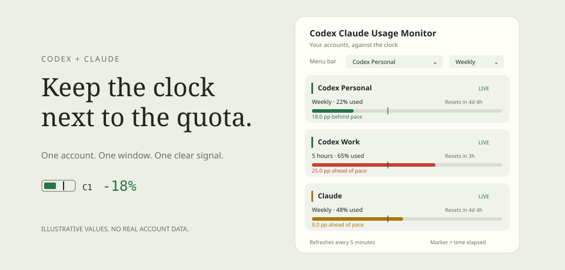

# Codex Claude Usage Monitor

[](https://github.com/johnrizzetto/codex-claude-usage-monitor/actions/workflows/ci.yml)
[](LICENSE)
[](#requirements)

**See how far ahead or behind you are against your AI usage limits.**

Codex Claude Usage Monitor is a small native Mac menu bar app for Codex and Claude subscriptions. Pick an account and a 5-hour or weekly window. The menu bar shows a quota bar and a signed difference from perfect pacing, colored green, yellow or red.

[Website and interactive demo](https://johnrizzetto.github.io/codex-claude-usage-monitor/) · [Download](https://github.com/johnrizzetto/codex-claude-usage-monitor/releases/latest) · [Report a bug](https://github.com/johnrizzetto/codex-claude-usage-monitor/issues/new/choose)



## What it does

- Monitors two independent Codex/ChatGPT account profiles and one Claude account.
- Shows provider-reported usage and reset timestamps, with pacing for each available window.
- Lets you choose the account and window shown in the menu bar. The choice survives restarts.
- Shows `+20%` when usage is 20 percentage points ahead of perfect pacing, or `-20%` when it is behind.
- Displays remaining allowance per hour and an estimate of when you would hit the limit at the window's average consumption rate.
- Refreshes every five minutes, with manual refresh, pause and launch-at-login controls.
- Runs without a Dock icon, web server, transcript scanning or third-party libraries.

## Requirements

- macOS 14 or later. This is a Mac app, not a Windows or Linux app.
- The official Codex CLI, or a supported installation of the ChatGPT desktop app that bundles it.
- The official Claude Code CLI for the initial Claude browser login.
- Subscription accounts that expose usage information. An API key alone does not provide subscription usage limits.
- Xcode Command Line Tools to build from source. Full Xcode is not required.

The app discovers CLIs in standard Homebrew and local install locations. Provider integrations may change. A missing window is shown as unavailable, never guessed or replaced with another account's quota.

## Installation

### Download an app

Choose the build matching your Mac from [Releases](https://github.com/johnrizzetto/codex-claude-usage-monitor/releases/latest), unzip it and move **Codex Claude Usage Monitor.app** to Applications. Release checksums are included alongside the downloads.

These builds are ad-hoc signed, not Apple Developer ID signed or notarized. macOS may decline to open a downloaded app. Building from source is an alternative. Only run a build whose source and origin you trust.

### Build from source

Install Xcode Command Line Tools if they are not already installed, then run:

```sh
git clone https://github.com/johnrizzetto/codex-claude-usage-monitor.git
cd codex-claude-usage-monitor
./test.sh
./build.sh
open "dist/Codex Claude Usage Monitor.app"
```

To install your build in your user Applications folder:

```sh
mkdir -p "$HOME/Applications"
ditto "dist/Codex Claude Usage Monitor.app" "$HOME/Applications/Codex Claude Usage Monitor.app"
open "$HOME/Applications/Codex Claude Usage Monitor.app"
```

## Connect your accounts

**Codex:** click the menu bar meter, then **Sign in with ChatGPT** on each Codex card. Choose the intended account in your browser and complete one login at a time. Each slot has an independent app-owned Codex profile. It does not switch the account used by your regular Codex app or terminal.

**Claude:** for automatic renewal, click **Keep Claude signed in**, complete one browser login through the official CLI in Terminal, then click **Connect Claude**. This creates a dedicated monitor session without switching your regular Claude Code account. The app stores the monitor session in its own Keychain item, renews it before expiry, and saves rotating refresh tokens. macOS may ask for Keychain approval when you first connect or install a rebuilt app.

Existing shared Claude Code logins still work through **Connect Claude**, but are read-only and depend on Claude Code to renew them. The dedicated login avoids competing with another app over shared refresh tokens. Do not use the monitor's `claude-profile` directory for regular CLI work.

Refresh runs every five minutes while healthy. Temporary failures retry after 30 seconds, then one, two, four and five minutes. The app refreshes after wake/unlock and when you open the popover. The refresh icon can request explicit Keychain approval; background refresh never prompts. Revoked or non-renewable sessions require a new login.

Click an account name to rename it. At the top of the popover, use the **Menu bar** selectors to choose the displayed account and **5 hours** or **Weekly**. Hover over the meter for the selected account and precise pacing details.

## How pacing works

Perfect pacing spreads the quota evenly over the provider's current window:

```text
window start = reset time - window duration
expected usage = elapsed time / window duration × 100
menu bar difference = usage percentage - expected usage
```

| Usage | Window elapsed | Menu bar | Meaning |
| --- | --- | --- | --- |
| 20% | 40% | -20% | You have used less than the paced allowance. |
| 40% | 40% | +0% | You are on pace. |
| 60% | 40% | +20% | You have used more than the paced allowance. |

The signed number is a **percentage-point difference**, not a relative speed multiplier. The bar's fill is quota used, and its marker is time elapsed.

The menu bar badge identifies the selected account. Edit the **BADGE** field on any account card to use up to four visible characters, including letters, numbers, emoji and symbols. Try **CP**, **CW**, **🧠CP** or **⭐**. Click the smiley button to open the native emoji and symbol picker, or paste a symbol directly. Return, Escape or clicking unused space ends editing. Your custom badge is saved across restarts. Clear the field to restore **C1**, **C2** or **CL**. Hover to see the full account name. Badge text stays neutral, emoji keep their native colors, and the pacing number and bar carry the signal color.

| Color | Rule |
| --- | --- |
| Green | On pace, behind pace, or no more than 3 percentage points ahead. |
| Yellow | More than 3 and up to 15 points ahead. |
| Red | More than 15 points ahead, or the limit has been reached. |
| Gray | Pacing is stale, unavailable or outside a valid reset window. |

The thresholds are display tolerances, not provider enforcement rules. Remaining allowance per hour is remaining quota divided by hours until reset. The exhaustion estimate assumes your average consumption across the current window continues. It cannot predict the cost of your next task.

## Privacy and credentials

Usage requests go directly to OpenAI or Anthropic. The app has no analytics, tracking server, model requests or browser scraping. The public website is a separate static demo hosted on GitHub Pages; it does not connect to your accounts.

App data lives in `~/Library/Application Support/UsagePace/`:

| Location | Contents |
| --- | --- |
| `codex-1/` and `codex-2/` | OAuth credentials managed and renewed by the official Codex CLI. These are plaintext files inside directories restricted to your user, not encrypted by this app. |
| `accounts.json` | Account labels, emails, usage snapshots, timestamps and connection state. No tokens. Treat this as personal data. |
| `claude-login.command` | A generated command invoking the official Claude login. No credentials. |
| macOS preferences | Your selected account and window, stored with UserDefaults. |

The dedicated Claude session is stored in the app-owned Keychain item `com.johnrizzetto.usagepace.claude.session`. Login bootstrap files or Keychain entries belong to a separate `claude-profile` directory under app data. The app renews only this monitor session. It never refreshes or writes your shared Claude Code credentials. Background Keychain reads and writes do not prompt. Codex token renewal is delegated to the official CLI, scoped to the app's own account homes.

Anthropic controls token lifetime and revocation. Automatic renewal keeps a valid session usable, but cannot extend a token's server-defined lifetime or restore a revoked grant. A locked Keychain can delay saving renewed tokens; the app keeps them in memory and asks you to unlock and manually refresh before quitting. Provider OAuth endpoints remain unofficial integrations and may change.

**Disconnect** removes an account from the monitor but retains its provider credentials. To remove app-owned Codex credentials, disconnect first and remove the relevant `codex-1` or `codex-2` folder through **Open app data folder**. This does not revoke tokens upstream. Use the provider's account controls for revocation. Never upload app data, tokens, credential files or unredacted account screenshots to an issue.

## Troubleshooting

- **Only a weekly window appears:** that is what the provider currently reported for the account. The app does not invent a 5-hour limit.
- **Gray `?%`:** reconnect or refresh. Missing resets, expired windows, provider errors and data older than ten minutes suppress pacing.
- **Claude login expired repeatedly:** choose **Keep Claude signed in** once to create the monitor session, then **Connect Claude**. A shared login cannot be renewed by the monitor.
- **Keychain approval required:** use the refresh icon to authorize access, without signing out. Unlock your Mac if storage was temporarily unavailable. App rebuilds can require a fresh Keychain grant.
- **A temporary refresh failed:** recent readings remain visible as `CACHED` with their original age. Data older than ten minutes still suppresses pacing. Automatic retries continue without pretending an old reading is live.
- **CLI not found:** install the official CLI in a supported location, then retry.
- **Launch at login does not work:** install the app in Applications and retry the setting. This uses macOS login-item services.
- **An issue persists:** open a bug report with macOS version, app version, provider, selected window and a sanitized description. Do not attach credentials or `accounts.json`.

## Development

```sh
./test.sh                     # Native pacing and parsing checks
./build.sh                    # Release app bundle and ad-hoc signature
swift build --disable-sandbox  # Development build
```

The dependency-free test harness runs with Command Line Tools, which do not bundle XCTest. CI runs the checks and app build on Apple silicon and Intel macOS runners. GitHub Actions are pinned to commit IDs, permissions are scoped to each workflow, and Dependabot maintains action versions.

See [CONTRIBUTING.md](CONTRIBUTING.md), [SECURITY.md](SECURITY.md) and the [architecture](docs/design.md). Public builds have not been independently security-audited. Live provider compatibility and OAuth consent still need manual testing. Tests do not certify the provider endpoints.

## Credits and license

Provider behavior was researched against the MIT-licensed [CodexBar](https://github.com/steipete/CodexBar) documentation and public source. No CodexBar source code is bundled.

Codex Claude Usage Monitor is independent of OpenAI and Anthropic. Codex, ChatGPT and Claude belong to their respective owners.

[MIT License](LICENSE), copyright John Rizzetto.
